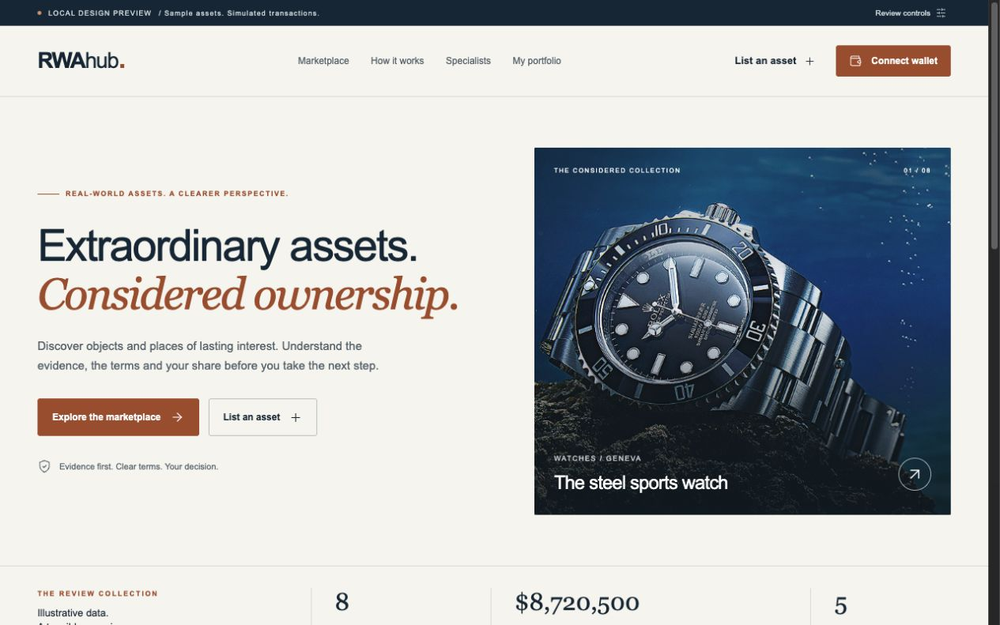

# RWAhub — Ownership, considered.

An interactive product-design review of RWAhub: a considered visual system, clearer asset evidence and complete simulated ownership journeys. Built for hands-on review on desktop and mobile.

**[Explore the live demo →](https://junglelaz.github.io/rwahub-design-review/)**

No account, API keys, browser wallet or installation required for the live demo.



## A five-minute tour

1. **Explore the marketplace.** Filter by category, condition, valuation and evidence status. Switch layouts, sort and load the remaining collection. Multimillion-dollar assets are visible by default.
2. **Open the steel sports watch.** Inspect sample evidence, fractional economics and ownership terms. Start a demo purchase; connecting the demo wallet resumes your action.
3. **Review your portfolio.** Completed purchases appear as holdings. Try the sapphire bid and tiara exchange to see pending activity kept separate from ownership.
4. **List an asset.** Walk through validation, sample evidence upload, specialist selection and the final submission review. Files remain on your device; only their names are recorded in your browser.
5. **Explore recovery states.** Open Review controls in the top banner for loading, unavailable inventory, empty inventory and wallet-network scenarios. Reset demo data to start again.

The [audit coverage map](docs/AUDIT_COVERAGE.md) connects all 19 findings to the corresponding product improvements. The [validation record](docs/VALIDATION.md) records the tested journeys and remaining boundaries.

## Run in your browser with Codespaces

[](https://codespaces.new/junglelaz/rwahub-design-review)

Create a Codespace using your GitHub account. Dependencies install automatically and the app starts on port **5180**. Open the forwarded port from the **Ports** panel if the preview does not open automatically. To restart it, run `npm run dev -- --host 0.0.0.0` in the terminal. Codespaces usage is subject to your own GitHub allowance.

## Run locally

Requirements: **Node.js 22 or newer** and npm.

```bash
git clone https://github.com/junglelaz/rwahub-design-review.git
cd rwahub-design-review
npm ci
npm run dev
```

Open **http://127.0.0.1:5180**. No environment file or external service is needed.

```bash
npm test          # Domain regression tests
npm run build     # TypeScript checks + production build
npm run preview   # Serve the production build locally
```

The production site is generated in `dist-review/`. Relative asset URLs and hash routing allow the same build to run on GitHub Pages or another static host, including a subdirectory.

## What is included

- React + TypeScript, Vite, React Router and Lucide line icons.
- Responsive homepage, marketplace, asset detail, personal portfolio, listing wizard, specialist profiles and ownership guidance.
- Local demo purchases, bids, exchange proposals, saved assets and submission records.
- A reproducible lockfile, nine regression tests and a ready-to-use development container.

## Review boundaries

This is an **independent design demonstration**, not an official RWAhub deployment or a live investment service. All assets, figures, documents, profiles and transactions are illustrative. A demo wallet never connects to a real wallet. No payment, blockchain minting, identity verification, custody or legal ownership occurs. Purchase activity is saved only in this browser; bids and exchanges remain pending. File contents are not uploaded.

The public package contains the standalone review experience. It does not run or publish upstream server credentials, wallet keys or production services.

## Source and attribution

This review was prepared from the publicly available [Blockvora-AI/RWAmarket project](https://github.com/Blockvora-AI/RWAmarket). RWAhub naming and inherited illustrative asset imagery belong to their respective owners. The redesign and simulated flows are presented for review; no affiliation, endorsement or transfer of rights in upstream materials is implied.

## Updating the hosted demo

The live site is served from the root of the `gh-pages` branch. After changing the source, run `npm ci`, `npm test` and `npm run build`, then publish the contents of `dist-review/` (including a `.nojekyll` file) to that branch. Keep the source on `main`.

